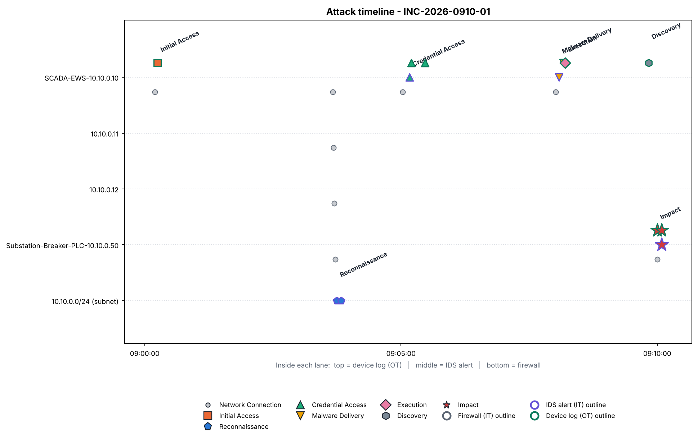
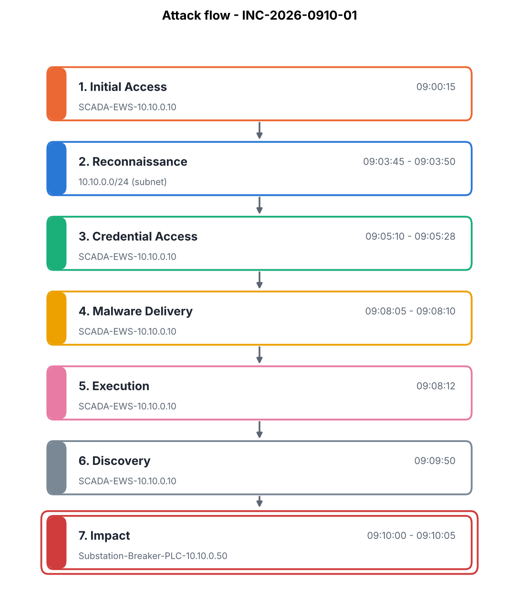
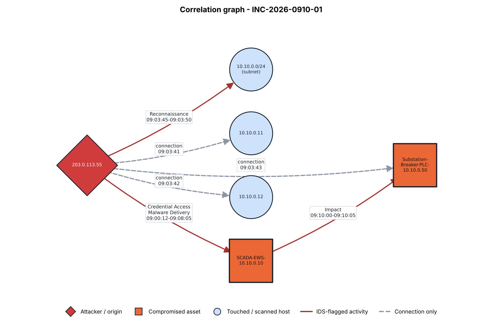

# Forensic Investigation Report - INC-2026-0910-01
*Generated: 2026-10-23 23:58:58*  
*Environment: Energy Plant IIoT / SCADA network*  
*Trigger: confirmed incident from SOC Alert Prioritization (Component 3) (priority Critical), window 2026-09-10 08:58:00 to 2026-09-10 09:15:00*

## 1. Incident Summary
The attack originated from an **external** source (**203.0.113.55**) and progressed through the stages **Initial Access -> Reconnaissance -> Credential Access -> Malware Delivery -> Execution -> Discovery -> Impact**. The following asset(s) show attacker activity or impact: **SCADA-EWS-10.10.0.10, Substation-Breaker-PLC-10.10.0.50**. Of **49** records collected in the incident window, **21** were correlated as attack evidence across 3 sources (IT: firewall/IDS, OT: device logs) and **28** were excluded as unrelated routine activity. The reconstructed timeline spans 09:00:12 to 09:10:05.

## 1b. Upstream Detection and Explanation Context
*These values are illustrative sample data used to demonstrate the handoff format. They are not output from a trained model.*

**Detection (Component 1 - ML-based IDS)**

| Field | Value |
|---|---|
| Model | Random Forest (sample) |
| Predicted class | Modbus write anomaly |
| Confidence | 0.94 |
| Detected at | 2026-09-10 09:10:06 |
| Alerts raised | 5 |

**Explanation (Component 2 - XAI, SHAP (sample))**

| Feature | Contribution | Direction |
|---|---|---|
| modbus_write_rate | 0.41 | raises risk |
| src_ip_is_new | 0.27 | raises risk |
| packets_per_second | 0.09 | raises risk |

A burst of Modbus writes from a host that had not written to this PLC before.

**Prioritization (Component 3 - SOC)**

| Field | Value |
|---|---|
| Priority score | 0.97 |
| Reason | Critical asset (breaker PLC) with a control write |

*Upstream values are reported as supplied by the other components. This framework does not verify them, and its own findings below are derived only from the collected logs.*

## 2. Evidence List (correlated records only)
| ID | Time | Source | Severity | Description |
|---|---|---|---|---|
| 255b77ba8a72 | 09:00:12 | firewall | Info | ALLOW TCP 203.0.113.55 -> 10.10.0.10:3389 |
| a5ef6b913198 | 09:00:15 | device | Info | [SCADA-EWS-10.10.0.10] LOGIN by unknown_admin: Remote desktop login succeeded from 203.0.113.55 |
| 264d78b0f878 | 09:03:40 | firewall | Info | ALLOW TCP 203.0.113.55 -> 10.10.0.10:22 |
| a1f144d651be | 09:03:41 | firewall | Info | ALLOW TCP 203.0.113.55 -> 10.10.0.11:22 |
| dacd3e870373 | 09:03:42 | firewall | Info | ALLOW TCP 203.0.113.55 -> 10.10.0.12:22 |
| 30bdd4b3d9ad | 09:03:43 | firewall | Info | ALLOW TCP 203.0.113.55 -> 10.10.0.50:502 |
| c8e5ec215cf0 | 09:03:45 | ids | Medium | ET SCAN Nmap Scripting Engine User-Agent Detected (Reconnaissance) |
| 5bf45545e2ab | 09:03:50 | ids | Medium | ET SCAN Suspicious Multi-Port Connection Attempt (Reconnaissance) |
| 76faf313ee73 | 09:05:02 | firewall | Info | ALLOW TCP 203.0.113.55 -> 10.10.0.10:22 |
| d6331c1b7e8e | 09:05:10 | ids | High | ET POLICY SSH Brute Force Login Attempt (Credential-Access) |
| d1dc9b15223c | 09:05:12 | device | Info | [SCADA-EWS-10.10.0.10] AUTH_FAIL by root: SSH authentication failed (4 attempts) |
| 5d93379c12a4 | 09:05:28 | device | Info | [SCADA-EWS-10.10.0.10] AUTH_SUCCESS by root: SSH authentication succeeded after brute force |
| fe266ee124d5 | 09:08:01 | firewall | Info | ALLOW TCP 203.0.113.55 -> 10.10.0.10:445 |
| 1aa4dc8cf4d4 | 09:08:05 | ids | Critical | ET MALWARE Possible Malicious Payload Upload via SMB (Malware) |
| c2aa4bf34efc | 09:08:10 | device | Info | [SCADA-EWS-10.10.0.10] FILE_WRITE by root: New executable written to /tmp/update_agent.bin |
| fa1ffba78092 | 09:08:12 | device | High | [SCADA-EWS-10.10.0.10] PROCESS_START by root: Process update_agent.bin started |
| f2321d1561c5 | 09:09:50 | device | Info | [SCADA-EWS-10.10.0.10] CONFIG_ACCESS by root: SCADA engineering software opened, substation project file loaded |
| cdac0fea401a | 09:10:00 | firewall | Info | ALLOW TCP 10.10.0.10 -> 10.10.0.50:502 |
| 32364c05790e | 09:10:00 | device | High | [Substation-Breaker-PLC-10.10.0.50] LOGIC_CHANGE by SCADA-EWS-10.10.0.10: Breaker control logic modified via Modbus write, trip setpoint register altered |
| bb3b6d09105b | 09:10:05 | ids | Critical | ET SCADA Modbus Write Function Code Anomaly - Breaker Control Register (ICS-Attack) |
| 2c353e9850f5 | 09:10:05 | device | High | [Substation-Breaker-PLC-10.10.0.50] STATE_CHANGE by SCADA-EWS-10.10.0.10: Breaker entered unexpected operational state (output override) - risk of unplanned trip |

## 3. Correlated IT-OT Evidence Clusters
**Cluster 1** - seed indicator `203.0.113.55` - sources: device, firewall, ids - 09:00:12 to 09:10:05 (21 records)

## 4. Attack Timeline
| Time | Stage | Asset | Source | Description |
|---|---|---|---|---|
| 09:00:12 | Network Connection | 10.10.0.10 | firewall | ALLOW TCP 203.0.113.55 -> 10.10.0.10:3389 |
| 09:00:15 | Initial Access | SCADA-EWS-10.10.0.10 | device | [SCADA-EWS-10.10.0.10] LOGIN by unknown_admin: Remote desktop login succeeded from 203.0.113.55 |
| 09:03:40 | Network Connection | 10.10.0.10 | firewall | ALLOW TCP 203.0.113.55 -> 10.10.0.10:22 |
| 09:03:41 | Network Connection | 10.10.0.11 | firewall | ALLOW TCP 203.0.113.55 -> 10.10.0.11:22 |
| 09:03:42 | Network Connection | 10.10.0.12 | firewall | ALLOW TCP 203.0.113.55 -> 10.10.0.12:22 |
| 09:03:43 | Network Connection | 10.10.0.50 | firewall | ALLOW TCP 203.0.113.55 -> 10.10.0.50:502 |
| 09:03:45 | Reconnaissance | 10.10.0.0/24 | ids | ET SCAN Nmap Scripting Engine User-Agent Detected (Reconnaissance) |
| 09:03:50 | Reconnaissance | 10.10.0.0/24 | ids | ET SCAN Suspicious Multi-Port Connection Attempt (Reconnaissance) |
| 09:05:02 | Network Connection | 10.10.0.10 | firewall | ALLOW TCP 203.0.113.55 -> 10.10.0.10:22 |
| 09:05:10 | Credential Access | 10.10.0.10 | ids | ET POLICY SSH Brute Force Login Attempt (Credential-Access) |
| 09:05:12 | Credential Access | SCADA-EWS-10.10.0.10 | device | [SCADA-EWS-10.10.0.10] AUTH_FAIL by root: SSH authentication failed (4 attempts) |
| 09:05:28 | Credential Access | SCADA-EWS-10.10.0.10 | device | [SCADA-EWS-10.10.0.10] AUTH_SUCCESS by root: SSH authentication succeeded after brute force |
| 09:08:01 | Network Connection | 10.10.0.10 | firewall | ALLOW TCP 203.0.113.55 -> 10.10.0.10:445 |
| 09:08:05 | Malware Delivery | 10.10.0.10 | ids | ET MALWARE Possible Malicious Payload Upload via SMB (Malware) |
| 09:08:10 | Malware Delivery | SCADA-EWS-10.10.0.10 | device | [SCADA-EWS-10.10.0.10] FILE_WRITE by root: New executable written to /tmp/update_agent.bin |
| 09:08:12 | Execution | SCADA-EWS-10.10.0.10 | device | [SCADA-EWS-10.10.0.10] PROCESS_START by root: Process update_agent.bin started |
| 09:09:50 | Discovery | SCADA-EWS-10.10.0.10 | device | [SCADA-EWS-10.10.0.10] CONFIG_ACCESS by root: SCADA engineering software opened, substation project file loaded |
| 09:10:00 | Network Connection | 10.10.0.50 | firewall | ALLOW TCP 10.10.0.10 -> 10.10.0.50:502 |
| 09:10:00 | Impact | Substation-Breaker-PLC-10.10.0.50 | device | [Substation-Breaker-PLC-10.10.0.50] LOGIC_CHANGE by SCADA-EWS-10.10.0.10: Breaker control logic modified via Modbus write, trip setpoint register altered |
| 09:10:05 | Impact | 10.10.0.50 | ids | ET SCADA Modbus Write Function Code Anomaly - Breaker Control Register (ICS-Attack) |
| 09:10:05 | Impact | Substation-Breaker-PLC-10.10.0.50 | device | [Substation-Breaker-PLC-10.10.0.50] STATE_CHANGE by SCADA-EWS-10.10.0.10: Breaker entered unexpected operational state (output override) - risk of unplanned trip |

## 4b. Evidence Visualization
**Attack timeline**

**Attack flow**

**Correlation graph (attack path)**

An interactive-style summary page is available as `dashboard.html` in the same folder.

## 5. Root Cause Analysis
- **Initial attack vector:** Initial Access
- **Origin type:** external
- **Entry point IP:** 203.0.113.55
- **Entry asset:** SCADA-EWS-10.10.0.10
- **Affected assets (touched):** SCADA-EWS-10.10.0.10, 10.10.0.11, 10.10.0.12, Substation-Breaker-PLC-10.10.0.50
- **Compromised assets (attacker acted / impact):** SCADA-EWS-10.10.0.10, Substation-Breaker-PLC-10.10.0.50
- **Stage sequence:** Initial Access -> Reconnaissance -> Credential Access -> Malware Delivery -> Execution -> Discovery -> Impact

## 6. Recommendations
- Block the external source 203.0.113.55 at the perimeter firewall and review all remote-access paths (VPN / RDP) that it used.
- Enforce multi-factor authentication and geo/time restrictions on remote and vendor accounts; rotate any credentials seen in the evidence.
- Enable account lockout / rate limiting and monitor repeated authentication failures; reset credentials on every compromised host.
- Quarantine the hosts that executed the dropped payload, collect a disk/memory image, and apply application allow-listing on engineering workstations.
- Restore the affected controller / relay / EMS configuration (logic, trip and protection setpoints) from a known-good backup and verify integrity before returning equipment to service.
- Add IDS signatures for unauthorised Modbus / IEC 60870-5-104 write or setpoint commands targeting protection and breaker registers.
- Keep firewall, IDS and OT device logs centrally collected and time-synchronised (NTP) to improve future correlation accuracy.

## 7. Evidence Integrity (Chain of Custody)
Source files were hashed (SHA-256) at collection time: 2026-10-23 23:58:56.

| File | SHA-256 |
|---|---|
| firewall.log | `02384239e7bdf7defa5ce5ac1c5c60522dacdd130eeb1126c639f223854c4bd6` |
| ids_alerts.log | `b1e0e2648a574d946b0ecf9e9a3588867e8dfd391d464b8fef4b557a5cd213ee` |
| device.log | `2dc372e924f3c75c5964560fbb378eea42626faa9e1ef0b846b53dc604b24056` |
| incident.json | `c1b8b3cc57ca458a2bf86f6feb522693dce5b11447b117c7b790e77750120b1f` |
